*This project has been created as part of the 42 curriculum by archowdh.*

# Codexion

## Description

Codexion is a concurrency simulation written in C with POSIX threads. Several coders sit around a table. Between each pair of neighbours lies one USB dongle, so there are as many dongles as coders. To compile, a coder needs **two** dongles at once, then debugs, then refactors, and repeats. A coder who does not start a compile within `time_to_burnout` ms burns out and the simulation stops. It also stops when every coder has compiled `number_of_compiles_required` times.

Each coder is a thread, and a separate monitor thread watches for burnout. Dongles are handed out by a scheduler (`fifo` or `edf`) backed by a hand-written priority queue (binary heap), and every dongle has a cooldown after being released.

### Demo

A normal `edf` run with `--color --details` until every coder has compiled 3 times, then a `fifo` run where `time_to_burnout` is too short and coder 1 burns out (real output, played back at real speed):



## Instructions

```
make                # builds ./codexion (-Wall -Wextra -Werror -pthread)
./codexion number_of_coders time_to_burnout time_to_compile time_to_debug \
           time_to_refactor number_of_compiles_required dongle_cooldown scheduler
```

`scheduler` is `fifo` or `edf`. All times are in milliseconds.

```
./codexion 5 2000 200 200 200 7 0 edf
```

Optional flags (after the 8 arguments, not needed for the normal output):

- `--details`: also prints dongle numbers and compile counts.
- `--color`: colours the log lines.

Other rules: `make clean`, `make fclean`, `make re`.

## Arguments

| Argument                      | Description                                           |
| ----------------------------- | ----------------------------------------------------- |
| `number_of_coders`            | Number of coder threads                               |
| `time_to_burnout`             | Maximum allowed time before a coder burns out         |
| `time_to_compile`             | Compilation duration                                  |
| `time_to_debug`               | Debugging duration                                    |
| `time_to_refactor`            | Refactoring duration                                  |
| `number_of_compiles_required` | Number of successful compilations required            |
| `dongle_cooldown`             | Time before a released dongle becomes available again |
| `scheduler`                   | Scheduling policy: `fifo` or `edf`                    |

Times are specified in milliseconds.

## How it works

1. `main` parses the arguments, creates the dongles (each with its own priority queue), then starts one thread per coder plus the monitor thread.
2. Coder `i` uses dongle `#i` and dongle `#i + 1` (the last coder wraps around to dongle `#1`). With one coder there is a single dongle, so it can never compile.
3. Every coder loops **compile, debug, refactor**. To compile it registers a request in the queue of both of its dongles.
4. The scheduler grants the dongles only if the coder is at the front of **both** queues, both dongles are free, and both cooldowns have passed. Otherwise the coder waits on a condition variable.
5. The queue order is the scheduler. Each request gets a **request order number** from a shared counter (taken under the mutex, so no two are equal), and a smaller number means an earlier request:
   - `fifo`: the smallest request order comes first.
   - `edf`: the earliest deadline comes first, where deadline = `last_compile_start + time_to_burnout`.

   **Tie-breaker:** if two deadlines are equal, the smaller request order wins, so the result is always deterministic.
   
   **Start-up order:** at the very beginning all coders would ask at almost the same moment, in random thread order, which can make the coders queue up in one long chain (only one compiles at a time). To avoid this, **odd-numbered coders ask first**: even-numbered coders wait `time_to_compile / 2` ms before their first request. Odd coders are neighbours only in one case (coder 1 and the last coder when the number of coders is odd), so most of them get the lowest request orders and compile in parallel, and the even coders follow. Later requests are ordered by when each coder finishes, and the rotation keeps going. This does not change any burnout deadline, because deadlines count from the start of the simulation.
6. When the compile ends, the coder releases both dongles, which start their cooldown, and wakes the waiting coders.
7. The monitor checks every millisecond. If a coder has not started a compile for `time_to_burnout` ms, it stops the simulation and prints `burned out`. The program ends when all coders have finished their compiles or someone burned out.

## Example

Five coders, 2000 ms to burn out, 200 ms per phase, 7 compiles required, no cooldown, `edf` (`./codexion 5 2000 200 200 200 7 0 edf`):

```
0 1 has taken a dongle
0 1 has taken a dongle
0 1 is compiling
0 3 has taken a dongle
0 3 has taken a dongle
0 3 is compiling
200 1 is debugging
200 3 is debugging
200 2 has taken a dongle
200 2 has taken a dongle
200 2 is compiling
200 5 has taken a dongle
200 5 has taken a dongle
200 5 is compiling
400 1 is refactoring
...
4403 4 is refactoring
```

Coders 1 and 3 do not share a dongle, so they compile at the same time. Every "is compiling" is preceded by exactly two "has taken a dongle" lines of the same coder, and the run stops on its own after everybody compiled 7 times.

**A burnout** (`./codexion 5 500 200 200 200 10 0 fifo`). One cycle takes 600 ms, which is longer than 500 ms, so a burnout is unavoidable. It is printed as the last line, within a few ms of the deadline:

```
...
401 4 is compiling
501 1 burned out
```

**A single coder** (`./codexion 1 800 200 200 200 10 0 fifo`) has one dongle and needs two, so it burns out at about 800 ms:

```
801 1 burned out
```

**With `--details`** (`./codexion 3 2000 100 100 100 2 0 fifo --details`):

```
0 1 has taken a dongle (dongle #2)
0 1 has taken a dongle (dongle #1)
0 1 is compiling (compile #1)
100 1 is debugging (compiles done: 1)
100 3 has taken a dongle (dongle #1)
100 3 has taken a dongle (dongle #3)
100 3 is compiling (compile #1)
```

## Test cases

| Command | Expected result |
|---|---|
| `./codexion 1 800 200 200 200 10 0 fifo` | Burnout at about 800 ms |
| `./codexion 5 2000 200 200 200 10 0 fifo` | No burnout, stops after 10 compiles each |
| `./codexion 5 2000 200 200 200 7 0 edf` | No burnout, stops after 7 compiles each |
| `./codexion 5 500 200 200 200 10 0 fifo` | Burnout at about 500 ms, and it is the last line |
| `./codexion 5 3000 200 200 200 10 400 fifo` | No burnout, no dongle taken again within 400 ms of its release |
| `./codexion 5 3000 200 200 200 10 800 fifo` then `edf` | The order in which waiting coders get dongles can differ |
| `./codexion 5 800 200 200 200 5 0 lifo` | Error (only `fifo` and `edf` are accepted) |
| `./codexion -5 800 200 200 200 5 0 fifo` | Error (invalid argument) |

Things to check in the logs: every "is compiling" has two dongle lines just before it, no two coders hold the same dongle at once, phases last about the configured time, and lines never mix. Timing can vary by a few milliseconds depending on the machine. With a very large cooldown (800) the schedule is so tight that a burnout can happen, which is normal.

Concurrency and memory checks (all report no errors and no leaks):

```
valgrind --tool=helgrind ./codexion 10 5000 100 100 100 3 0 edf
valgrind --tool=drd      ./codexion 10 5000 100 100 100 3 0 edf
valgrind --leak-check=full ./codexion 5 500 200 200 200 10 0 fifo
cc -Wall -Wextra -Werror -pthread -fsanitize=thread -Iinclude src/*.c -o codexion && ./codexion 10 5000 100 100 100 3 0 edf
```

## Resources

- `man pthread_create`, `pthread_mutex_lock`, `pthread_cond_wait`, `pthread_cond_broadcast`
- Dijkstra's Dining Philosophers problem and Coffman's four deadlock conditions
- Earliest Deadline First scheduling; binary heaps (Cormen et al., *Introduction to Algorithms*)
- Valgrind manual: Helgrind and DRD; ThreadSanitizer documentation
- AI was used as a learning assistant to understand concepts such as threads, mutexes, condition variables, and concurrency.Explained how Helgrind, DRD, Valgrind memcheck and ThreadSanitizer work, how to read their reports etc. It also helped me design additional test cases to cover different scheduling and synchronization scenarios. It helped me draft and structure this README.

## Blocking cases handled

- **Deadlock:** a coder is granted both dongles in a single atomic step, or none. It never holds one dongle while waiting for the other, which removes *hold and wait*.
- **Starvation:** requests are ordered by the scheduler. `fifo` serves arrival order. `edf` serves the earliest deadline (`last_compile_start + time_to_burnout`), with arrival order as the tie-breaker. Even-numbered coders delay their first request by `time_to_compile / 2`, so neighbours do not all queue in one long chain.
- **Cooldown:** each dongle stores the time it becomes usable again. A coder that is next in line but still waiting for the cooldown sleeps in short steps (at most 5 ms) with the mutex released.
- **Precise burnout:** the monitor checks every millisecond, so burnout is printed within a few ms of the deadline. Coders that already finished all their compiles are not treated as burned out.
- **Log serialization:** all output goes through one mutex. The two "has taken a dongle" lines and "is compiling" are printed together, and nothing is printed after "burned out".
- **Single coder:** one dongle exists, so the coder can never compile and burns out at `time_to_burnout`.

## Thread synchronization mechanisms

- **`pthread_mutex_t mutex`** protects all shared state: dongle availability and cooldown times, the priority queues, compile counters and the stop flag. Coders and the monitor only read or change these while holding it.
- **`pthread_cond_t condition`** lets a coder that cannot get its dongles sleep with `pthread_cond_wait`, which releases the mutex and sleeps atomically. `pthread_cond_broadcast` wakes the waiters when a dongle is released or the simulation stops.
- **`pthread_mutex_t log_mutex`** keeps log lines from mixing.
- **Coder to monitor communication:** the monitor reads `last_compile_start_time` and `number_of_compiles` under the same mutex that coders use to write them, so there is no data race. On burnout the monitor sets `simulation_stop` and broadcasts, and every waiting coder wakes up and exits.
- **No global variables:** everything lives in the `t_simulation` structure that is passed to each thread.

The program was checked with `valgrind --tool=helgrind`, `valgrind --tool=drd`, `-fsanitize=thread` and `valgrind --leak-check=full`, with no errors reported.